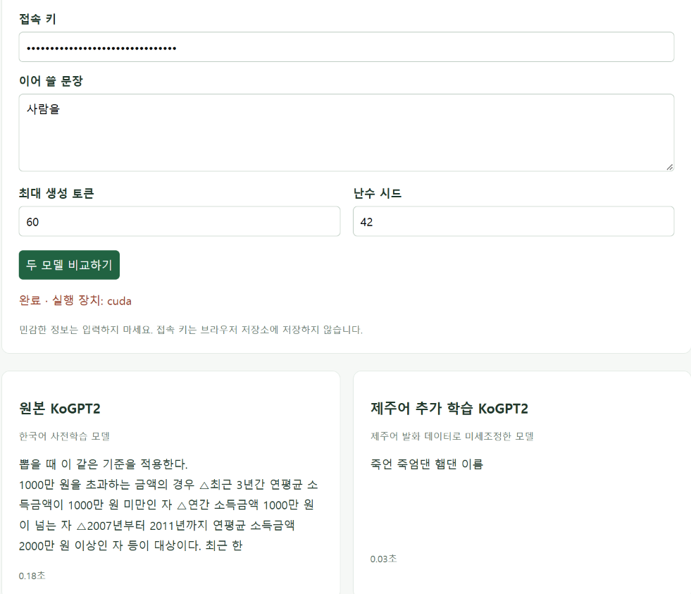
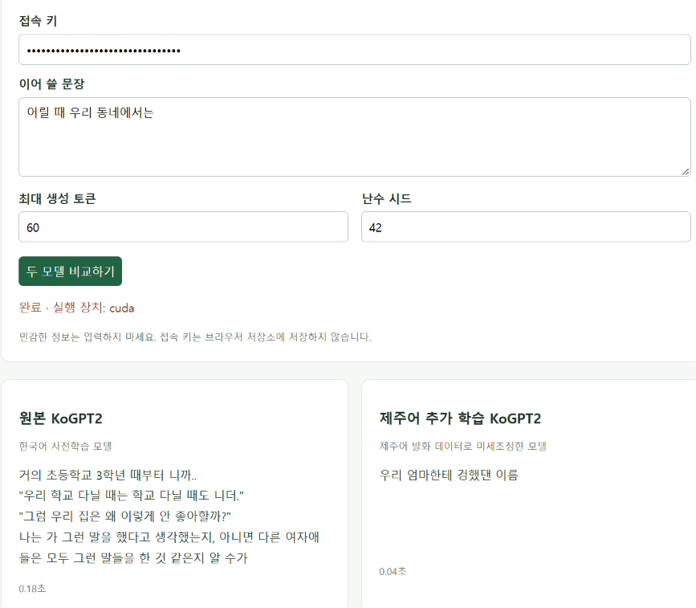

# KoGPT-Jeju

**제주어 데이터로 KoGPT2를 미세조정하고, 원본·Full fine-tuning·LoRA의 성능과 생성 결과를 비교하는 프로젝트입니다.**

AI Hub의 제주도 방언 발화 전사문을 사용해 한국어 사전학습 모델의 도메인 적응을 실험합니다. 동일한 테스트 데이터에서 Perplexity와 학습시간을 비교하고, FastAPI 웹 화면에서 문장 이어쓰기 결과를 확인할 수 있습니다.

## 주요 기능

- 대화 단위 학습·검증·테스트 분할과 중복 문장 제거
- 원본 KoGPT2에서 각각 시작하는 Full fine-tuning 및 LoRA 학습
- Base·Full·LoRA의 PPL, 학습시간, 학습 가능한 파라미터 수 비교
- 학습 곡선과 동일 프롬프트 5개의 생성 결과 출력
- 측정값 기반 결론과 실행 출력이 포함된 보고서 노트북 생성
- 원본 모델과 선택한 미세조정 모델을 비교하는 웹 화면

## 웹 화면

입력한 문장 뒤에 이어지는 **생성 부분만** 표시합니다. 웹에서는 원본과 선택한 모델 하나를 비교하며, 세 모델의 전체 비교는 보고서에서 확인합니다.



<details>
<summary>다른 입력 예시</summary>



</details>

화면 이미지는 사용 예시입니다. 정량 성능은 각 실험의 테스트 평가 결과로 확인합니다.

## 데이터셋

[AI Hub 한국어 방언 발화(제주도)](https://aihub.or.kr/aihubdata/data/view.do?dataSetSn=121)의 **비식별화완료 제주도 학습용데이터 1**을 사용합니다. 음성 대신 JSON에 포함된 발화 전사문을 학습합니다.

제주어 어휘와 어미, 일상 대화의 구어체 표현에 모델이 적응하는 과정을 관찰하기 위해 선정했습니다. 표준형과 방언형을 비교해 발화를 선택할 수 있고, 대화 ID를 이용해 분할할 수 있다는 특징이 있습니다. 학습 목표는 **문장 이어쓰기**이며 번역이나 질문·답변 학습은 수행하지 않습니다.

### 정제와 분할

1. 표준형과 발화 표기가 같은 문장은 제외합니다.
2. 비식별화 표시가 포함된 발화는 제외합니다.
3. 어절별 슬래시 앞 표현을 사용하고 한글·한글 자모만 남깁니다.
4. 정제 후 2어절 미만인 발화는 제외합니다.
5. 대화 파일 단위로 약 80/10/10을 분할하고, 학습→검증→테스트 순서로 완전히 같은 문장을 제거합니다.

준비된 표본은 원천 JSON **5,042개 중 시드 42로 선택한 300개**입니다.

| 분할 | 대화 파일 | 정제 후 문장 |
| --- | ---: | ---: |
| 학습 | 240 | 53,561 |
| 검증 | 30 | 6,478 |
| 테스트 | 30 | 5,032 |

파일 선택 목록, 제거 건수, 분할별 SHA-256은 `prepared/data_report.json`에 기록됩니다. 데이터 선택을 바꾸면 위 건수도 달라지며, 보고서는 해당 실행의 실제 건수를 표시합니다.

## 모델과 학습 설정

기반 모델은 [skt/kogpt2-base-v2](https://huggingface.co/skt/kogpt2-base-v2)입니다. 한국어 생성 사전학습 모델이며, 단일 GPU에서 전체 파라미터 학습과 LoRA를 비교하기에 적합한 규모이고 수업 예제의 GPT 구조와 연결하여 이해하기 쉽습니다.

**Full fine-tuning**은 모든 파라미터를 업데이트합니다. **LoRA**는 원본 파라미터를 고정하고 attention의 Q/K/V 결합 투영층인 `c_attn`에 저랭크 어댑터를 학습합니다. 두 방식은 각각 원본 모델에서 시작해 순차 실행됩니다.

| 설정 | 기본값 | 선정 이유 |
| --- | --- | --- |
| 에포크 | 3 | 실행 비용을 제한하고 검증 손실로 최적 에포크 선택 |
| 배치 크기 | 32 | GPU 처리량 확보를 위한 시작값 |
| 최대 길이 | 128토큰 | 짧은 발화 중심의 데이터와 계산량 고려 |
| Full 학습률 | 5e-5 | 사전학습 가중치의 급격한 변화 억제 |
| LoRA 학습률 | 2e-4 | 새 어댑터 학습에 더 큰 초기 학습률 적용 |
| LoRA r / alpha / dropout | 8 / 16 / 0.05 | 어댑터 용량 제한과 과적합 완화 |
| 옵티마이저 | AdamW, weight decay 0.01 | 가중치 감쇠를 포함한 업데이트 |
| 정밀도 / 시드 | FP32 / 42 | 구현 단순화와 재현성 확보 |

문장은 BOS + 최대 126개 내용 토큰 + EOS로 구성합니다. 패딩은 손실에서 제외합니다. 두 방식은 같은 분할·토크나이저·배치·에포크를 사용하지만 학습률이 다르므로, 명시한 **두 학습 구성의 비교**로 해석합니다. 위 설정이 최적이라는 의미는 아닙니다.

## 빠른 시작

Linux / RunPod GPU, Python 3.10 이상을 기준으로 합니다. 프로젝트를 `/workspace/kogpt-jeju`에 배치합니다

### 1. 환경 설치

```bash
cd /workspace/kogpt-jeju
bash setup.sh
```

최초 모델 다운로드에는 인터넷 연결이 필요합니다. 로그의 `CUDA: True`로 GPU 사용 여부를 확인합니다.

### 2. 데이터 준비

**준비된 `prepared/` 폴더가 있다면 폴더 전체를 업로드하고 다음 단계로 넘어갑니다.** Git에는 포함되지 않으므로 별도로 옮겨야 합니다.

원천 JSON에서 직접 준비하려면:

```bash
source .venv/bin/activate
python prepare_data.py --source "/path/to/jeju/json" --max-files 300 --seed 42
```

`--max-files 0`은 전체 파일을 사용합니다. 기존 데이터 폴더를 덮어쓰지 않으므로 재생성할 때는 `--output prepared-v2`처럼 새 경로를 지정합니다.

### 3. Full·LoRA 학습 및 평가

```bash
bash setup.sh experiment
```

설정을 직접 지정할 수도 있습니다.

```bash
source .venv/bin/activate
python experiment.py --data prepared --output outputs/assignment4 --batch-size 32 --epochs 3
```

학습 → 최적 에포크 선택 → 세 모델의 테스트 평가 → 생성 비교 → 보고서 생성 순서로 실행됩니다. 기본 결과 경로는 `outputs/assignment4/`입니다.

GPU 메모리가 부족하면 배치를 낮춰 새 출력 폴더에서 두 방식 모두 다시 실행합니다.

```bash
python experiment.py --batch-size 16 --output outputs/assignment4-b16
```

기존 결과는 덮어쓰지 않으며 중단된 학습의 자동 재개는 지원하지 않습니다.

### 4. 웹에서 모델 비교

전체 미세조정 모델:

```bash
MODEL_DIR=outputs/assignment4/full bash setup.sh serve
```

LoRA 모델은 실행 중인 서버를 종료한 뒤 선택합니다.

```bash
MODEL_DIR=outputs/assignment4/lora bash setup.sh serve
```

RunPod에서 HTTP 포트 **8000**을 공개하고 해당 서비스에 접속합니다. 터미널에 표시되는 **접속 키**를 웹 화면에 입력합니다. 서버는 `0.0.0.0:8000`에서 실행되며, 12자 이상의 `APP_TOKEN` 환경변수로 키를 직접 지정할 수도 있습니다.

LoRA는 어댑터 형태로 저장되므로 로딩 시 원본 KoGPT2도 필요합니다.

## 평가와 보고서

Perplexity는 **유효한 예측 대상 토큰의 평균 음의 로그우도에 지수 함수를 적용한 값**입니다. 각 배치 손실을 토큰 수로 가중 평균한 뒤 계산하며, 배치별 PPL을 단순 평균하지 않습니다.

검증 데이터로 최적 에포크를 선택하고, 두 방식의 학습이 끝난 후 동일한 테스트 데이터로 최종 평가합니다. PPL이 낮을수록 해당 토큰을 더 잘 예측한 것이며 제주어 정확도나 번역 점수는 아닙니다.

```text
outputs/assignment4/
├── full/                         # 전체 미세조정 모델
├── lora/                         # LoRA 어댑터와 토크나이저
├── experiment_report.json        # 설정·환경·분할·평가·생성 결과
├── comparison.csv                # Base / Full / LoRA 비교표
├── loss_curves.png               # 학습·검증 loss 곡선
├── conclusion.md                 # 측정값 기반 결론
└── 과제4-202435119-한여원.ipynb    # 실행 출력과 그래프 포함 보고서
```

`train_seconds`는 학습 반복에 걸린 시간이고, `fit_seconds`는 에포크 검증과 체크포인트 저장까지 포함합니다. 모델 다운로드·토큰화·최종 테스트 시간은 제외합니다.

동일 프롬프트 5개에 같은 생성 설정을 적용하여 세 모델의 출력을 기록합니다. 보고서에는 데이터·모델·설정 선정 이유, 분할 건수, 비교표, 그래프, 생성 결과와 결론이 포함됩니다. 실제 실험이 끝나야 수치와 실행 출력이 채워집니다.

학습 후 보고서만 다시 생성하려면:

```bash
source .venv/bin/activate
python make_report.py --run-dir outputs/assignment4
```

루트의 노트북은 템플릿입니다. 제출에는 **실험 폴더에 생성된 출력 포함 노트북**을 사용합니다.

## 프로젝트 구조

```text
kogpt-jeju/
├── prepare_data.py              # 원천 JSON 정제·대화 단위 분할
├── experiment.py                # Full·LoRA 학습과 공통 평가
├── make_report.py               # 표·그래프·결론·실행 노트북 생성
├── 과제4-202435119-한여원.ipynb   # 보고서 템플릿
├── common.py                    # 모델 경로와 토크나이저
├── app.py / index.html          # FastAPI 비교 서버와 웹 화면
├── setup.sh / requirements.txt  # 설치 및 실행
├── results/                     # 웹 화면 이미지
├── prepared/                    # 비교 실험 데이터 (Git 제외)
└── outputs/                     # 모델 및 실험 결과 (Git 제외)
```

`setup.sh`는 `install`(기본값), `experiment`, `serve` 세 명령을 제공합니다. 서버의 기본 모델 경로는 `outputs/assignment4/full`이며 `MODEL_DIR`로 변경할 수 있습니다.

## 해석의 범위

- 대화 ID와 완전히 같은 문장의 분할 간 중복은 검사하지만, 파일 간 동일 화자나 유사 문장까지 배제하지는 않습니다.
- 방언형 발화만 선택하고 짧은 발화·숫자·문장부호를 제외하므로 원천 대화 전체의 분포와 차이가 있습니다.
- PPL과 생성 예시만으로 자연스러운 제주어 사용이나 사실 정확성을 보장할 수 없습니다.
- 단일 시드와 선택한 표본에 대한 결과이므로, 방식별 일반적인 우열을 단정하지 않습니다.
- 모델의 문맥 연결·반복·짧은 응답은 생성 결과를 직접 읽고 함께 판단합니다.

## 모델 보관과 문제 해결

실험 폴더 전체를 압축하면 모델과 보고서를 함께 보관할 수 있습니다.

```bash
tar -czf jeju-experiment.tar.gz -C outputs assignment4
```

다운로드한 파일이 정상적으로 풀리는지 확인한 뒤 Pod를 정리합니다. 모델을 다시 사용할 때는 가중치뿐 아니라 설정과 토크나이저도 함께 복원합니다.

| 상황 | 조치 |
| --- | --- |
| CUDA 메모리 부족 | 두 방식의 배치를 동일하게 낮추고 새 출력 폴더 사용 |
| 모델 파일 없음 | 학습 완료 여부와 MODEL_DIR 확인 |
| 기존 출력 폴더 오류 | --output에 새로운 경로 지정 |
| 노트북 생성 실패 | 학습 완료 후 make_report.py로 보고서 재생성 |
| 웹 요청 시간 초과 | 생성 토큰 수와 GPU 사용 여부 확인 |
| 모델 변경 미반영 | 서버 종료 후 원하는 MODEL_DIR로 재시작 |

## 참고

데이터·가중치·가상환경은 Git에서 제외합니다. 원천 데이터와 기반 모델의 이용 조건은 각 배포처에서 확인합니다.

- [AI Hub 한국어 방언 발화(제주도)](https://aihub.or.kr/aihubdata/data/view.do?dataSetSn=121)
- [KoGPT2 모델 카드](https://huggingface.co/skt/kogpt2-base-v2)
- [PEFT LoRA](https://huggingface.co/docs/peft/package_reference/lora)
- [Perplexity 계산](https://huggingface.co/docs/transformers/perplexity)
- [RunPod HTTP 포트](https://docs.runpod.io/pods/configuration/expose-ports)
